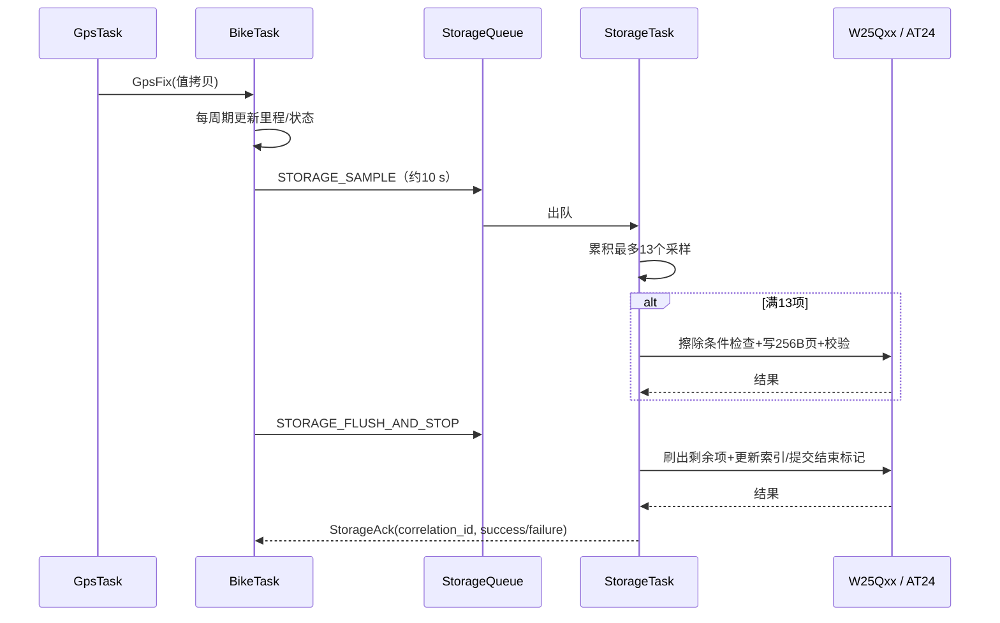

# BikeTrace：STM32 MCU + FreeRTOS 重构设计说明书

> 版本：V1.1（交付 Codex 的实施级设计规范）  
> 基线：用户提供的 `BikeTrace_Path_Reload - 简历包装.rar`，工程根目录 `BikeTrace_src/`  
> 交付目标：在保留原功能和历史数据的前提下，将当前 STM32 HAL 裸机轮询架构迁移至可调试、可测试、可回退的 FreeRTOS 架构。  
> 状态：**设计文档，不代表固件已经迁移或通过实物验证**。  
> 适用环境：Mac + VMware Fusion Windows 虚拟机 + Keil μVision；原工程 Keil ARM Compiler 5，已由用户实际编译通过（0 Errors，12 Warnings）。

---

## 0. 给 Codex 的核心命令（先读）

1. **不要一次性重写所有代码。** 先扫描和构建原工程，创建新分支/工作副本，保存原始 `BikeTrace.uvprojx`、`.ioc`、Flash 格式及源文件。
2. **硬件型号是阻塞条件。** 原工程真实目标为 `STM32F103C8T6`，20 KB SRAM / 64 KB Flash；用户称有硬件，但尚未明确最终采用 F103C8、F103RCT6 还是其他 MCU。不得假定换板后旧工程能直接运行。在 `target_config.md` 中记录实物芯片丝印、SRAM/Flash、晶振、Flash JEDEC ID、OLED/磁力计型号；未核实前只能完成与具体硬件无关的代码和构建迁移。
3. **推荐完整版目标为 STM32F103RCT6（48 KB SRAM / 256 KB Flash）**，前提是用户实物确实有这块板；它需重建对应 MCU/启动文件/链接内存区域/引脚配置。若用户只有 F103C8，则先做 2–3 任务的精简 RTOS 验证，必须过内存门禁，再决定是否扩展。F4 系列是独立硬件移植项目，不能混入此轮 F1 迁移。
4. **禁止无许可擦除任何外部 Flash/EEPROM 既有数据。** 先确定格式、地址空间和备份手段；调试命令 `clear data` 必须改为需要显式确认的受保护操作。
5. 每个阶段提交可审查的差异、Keil 构建结果（或明确说明未能在当前环境运行 Keil）、内存统计、最少量的单元测试、风险清单、下一阶段计划。

## 1. 项目目标、范围与非目标

### 1.1 原项目功能

- STM32F103 主控；USART3 接 GPS（9600 8N1），USART2 接 EC600N（115200），USART1 用于调试命令。
- 软件 I²C：PB6/PB7，连接 OLED、AHT21、HMC5883L、AT24C02（实际模块/地址需实物核实）。
- SPI1：PA4–PA7，连接 W25Qxx NOR Flash。
- PA0 骑行 LED、PA1 GPS LED；PC14/PB0 两个按键。
- `bike.c` 包含 IDLE → RIDE → STOP 状态机、骑行计时、GPS 速度里程、温湿度、OLED、网络请求和存储触发。
- `network.c` 使用 cJSON 解析 `time response`、`path_plan`，以 `upload data` 上传骑行状态。
- `flash_data.c` 每次 `save_item` 缓存位置/速度采样，通常 13 项组成 256 字节记录；`flash_index.c` / `restore.c` 管理索引与恢复信息。

### 1.2 本次重构必须交付

- FreeRTOS 内核可启动，任务调度正确，SysTick / PendSV / SVC 与 HAL 时基无冲突。
- 数据所有权明确：Bike 独占骑行状态；Network 独占 EC600N/AT；Storage 独占 W25Qxx 记录及 EEPROM 存储接口；UI 独占 OLED 显示。传感器/I²C 通过统一总线管理。
- UART ISR 仅作限时缓冲和通知，不运行存储擦除、JSON 或网络等重业务。
- 完整 IDLE / RIDE / STOP 流程；1 s 业务时基稳定；GNSS 无效/数据过期时不累计虚假距离。
- 轨迹提交/异常掉电恢复具有结果确认、错误状态及可重复测试用例；保留旧存储格式的读取兼容性。
- 网络通信和本地存储对 Bike 的计时影响可观测，失败可恢复，队列满时有明确策略。
- 代码分层清晰、可以在 Keil 中逐任务调试，带日志、错误计数、栈高水位、堆剩余量与测试报告。

### 1.3 非目标（首轮不做）

- 不自研完整地图寻路算法；导航路径仍由云端提供。
- 不迁移到不同 STM32 系列（如 F446）并同时改 RTOS；如选 F446，应另立硬件移植阶段。
- 不立即引入文件系统、蓝牙、Bootloader/OTA、屏幕 GUI 框架。
- 不声称“加上 FreeRTOS 就提高实时性”：必须测量任务执行时间、阻塞和响应。
- 不更换云端协议或固定服务器地址而不先做兼容测试；不得将旧测试 IP 当作可用的生产服务器。

## 2. 源码核查基线（重要：这是根据实际源码，不是想象）

| 路径与符号 | 核查结果 | 本轮处理 |
|---|---|---|
| `Core/Src/main.c` | `while(1)` 调用 GPS 解析及 `bike_handle()`；另有 `test(time_str, dis_km)` 递增测试距离并消费 TIM2 标志 | 移除正式构建中的测试路径；主循环改 RTOS scheduler |
| `APP/src/bike.c::bike_handle()` | `bike_handle_key()`、`bike_update()` 均被注释；云端接收与导出仍执行 | 不简单取消注释；拆为独立业务职责及任务消息 |
| `APP/src/bike.c::bike_update()` | 约 1 s 触发；约 2 s 上传、10 s 采样、180 s 请求时间，网络/显示/存储混在一起 | Bike Task 只计算/发布命令，其他模块异步执行 |
| `BSP/src/bsp_uart_driver.c::HAL_UART_RxCpltCallback()` | USART2/3 单字节中断；USART1 直接运行 `cmd_revevied()` | ISR 只入缓冲/发通知；调试命令在 Debug Task/低优先级服务中解析 |
| `BSP/src/bsp_uart_driver.c::cmd_revevied()` | 16 字节缓冲未先检查边界；`clear data` 可直接整片擦除；甚至在接收回调里运行 | 增长并限长；独立任务处理；禁止无确认擦除 |
| `BSP/src/bsp_gps_driver.c::rec_gps_data_to_get_gprmc()` | 接收缓冲 256 字节；解析缓冲 128 字节；未严格检查复制长度和写末尾下标 | 帧边界、长度、NMEA checksum、双缓冲/队列；异常帧丢弃 |
| `BSP/src/bsp_timer_driver.c` | TIM2 ~1 s 回调设置 0/1 标志；标志不带事件计数 | 迁移为任务时间基准，取消主循环争用标志 |
| `APP/src/network.c::bike_cloud_recv_data()` | 2048 字节静态缓冲，超时复位时机有风险；TCP 未明确帧封装，拆包/粘包问题 | 网络协议收帧层、长度上限和多消息处理 |
| `APP/src/network.c::parse_json_path_plan()` | `malloc(sizeof(Step)*step_count)`，早期出错路径 `free`；旧路径重解析/长度限制需审计 | 定长限制/预分配或受控分配，旧路径成功替换时释放与原子提交 |
| `BSP/src/at_ec600n_handler.c::at_wait_for_response()` | 512 字节栈缓冲 + 忙等 ringbuffer | 改为事件等待/超时状态机，Network Task 独占 AT 事务 |
| `APP/src/flash_data.c::save_item()` | 静态 13 项采样缓存；13 条或 STOP 时同步写 Flash、EEPROM；返回值未可靠传递 | Storage Task 独占写入；异步写结果/停止提交 ACK；处理失败重试 |
| `APP/src/flash_index.c` | `PAGE_SIZE` 宏值 `16` 与硬件 256B 页概念不同，容易冲突；16 个骑行分区/index | 重命名 `INDEX_SLOT_COUNT` 等；保留旧布局与兼容解码 |
| `APP/src/restore.c` | EEPROM 结束标志和最后记录恢复；自动恢复调用在 `bike_update()` 里被注释 | 两阶段恢复校验、状态重建、明确异常断电策略 |
| `APP/src/utils.c::calc_average_speed()` | 单位换算需修正并做零分母保护 | `distance_km*3600/total_time_sec` + 测试 |
| `BSP/src/bsp_key_driver.c::GetKey1Val/GetKey2Val()` | `key_val` 某些状态路径未赋初值 | 每次默认 `KEY_NOT_PRESS`，稳定按键轮询周期 |
| `Core/Src/gpio.c` | PB6/PB7 软件 I²C 配置为 GPIO push-pull 输出 | 先验证硬件及软件 I²C 驱动；共享总线改符合 I²C 电气要求的开漏/释放 SDA 设计 |
| `BikeTrace.ioc` | 存在 USART2/3 DMA 配置，但 `main.c` 中 `MX_DMA_Init()` 被注释；当前实际用 `HAL_UART_Receive_IT` | 初版保留中断接收；单独阶段切 DMA 环形接收，不直接视为已启用 |

### 2.1 构建与资源基线

原 Keil 产物显示：`Code=44208`、`RO-data=2828`、`RW-data=2420`、`ZI-data=13188`；静态 RAM 合计 15,608 B，F103C8 20 KB RAM 仅剩约 4,872 B（尚未考虑可用栈/堆及 RTOS 新增内存）。原固件仅在已配置目标上编译通过，不代表在另一块板上可直接下载。

**工程门禁：** 原包先做 git 初始化/基线 commit，保存编译输出和 map；迁移后每一阶段重复统计 `Code + RO` 与 `RW + ZI + 任务栈 + RTOS 堆`。严禁“内存看起来够”就上板。

## 3. 硬件目标与兼容性策略

### 3.1 两种可执行构建 profile

| Profile | 芯片 | 策略 | 放行条件 |
|---|---|---|---|
| `BIKETRACE_F103C8_LITE` | STM32F103C8T6，64K Flash/20K RAM | 2–3 个任务起步：控制、通信、存储/UI 协作；显著压缩静态缓冲；cJSON 先可选禁用或精简 | linker 不溢出、含安全栈余量、基础任务稳定 |
| `BIKETRACE_F103RC_FULL`（推荐） | STM32F103RCT6，256K Flash/48K RAM | 五任务完整版，必要时合并任务；独立队列和监控 | 确认实物 MCU、晶振、引脚后重新配置 `.ioc`/启动文件/链接区 |

> F103RCT6 和 F103C8T6 **不是可直接替换的同封装引脚 MCU**。使用 RCT6 开发板必须将实际连线和 GPIO/peripheral AF 重新审计。不可只改 Keil Device 字段。

### 3.2 设备接口和电气核查

| 接口 | 旧工程配置 | 注意 |
|---|---|---|
| USART1 | PA9/PA10 调试 | Debug Task 输出限速；不在 ISR 中 `printf` |
| USART2 | PA2/PA3 EC600N | 模块供电独立、核对 UART 电平/模块载板；AT 事务唯一所有者 |
| USART3 | PB10/PB11 GPS | 9600 8N1；校验和及无效定位处理 |
| SPI1 | PA4 CS、PA5 SCK、PA6 MISO、PA7 MOSI | W25Qxx JEDEC ID、实际容量、擦除页与电源检查 |
| 软件 I²C | PB6 SCL / PB7 SDA | OLED/AHT21/HMC5883L/EEPROM 共线时需总线仲裁/开漏行为及地址冲突检查 |
| 按键 | PC14、PB0 | 20 ms 按键扫描、消抖与短/长按 |
| LED | PA0 RIDE、PA1 GPS | 低电平有效，以实际板电路为准 |
| SWD | PA13/PA14 | Keil 下可调试；VMware USB 调试器直通 |

### 3.3 云端外部依赖

`bike.c` 中有硬编码 `39.108.115.184:8081`（原样保留用于审计，**不保证仍可用**）。改为 `config.h` 中的设备服务端配置，不将旧服务器作为测试通过前提。先实现本地/可控模拟服务端和样例响应；网络真实联调由用户提供服务器地址和协议测试环境后再进行。

## 4. 目标架构与任务职责

### 4.1 系统层次

```text
 ┌────────────────────────────── Application ──────────────────────────────┐
 │ BikeTask      GpsTask      NetworkTask      StorageTask      UiTask    │
 │ 业务状态       NMEA解码       AT/TCP/JSON        Flash/EEPROM        OLED   │
 └───────────────┬────────────────────┬─────────────────────┬──────────────┘
                 │ Queue/Notification│        Snapshot     │
 ┌───────────────┴────────────────────┴─────────────────────┴──────────────┐
 │                       BSP / HAL adapter                               │
 │ UART1/2/3  SPI1  software I2C  GPIO  Timer  W25Qxx  GNSS  EC600N      │
 └──────────────────────────────┬────────────────────────────────────────┘
                                │
                      STM32F103 MCU + FreeRTOS
```

### 4.2 FULL 模式的初始任务建议（**不是最终确定栈尺寸**）

| 任务 | 初始优先级（数值越大越高） | 激活方式 | 初始栈深度（word） | 数据所有权/限制 |
|---|---:|---|---:|---|
| `GpsTask` | 4 | USART3 字节事件/StreamBuffer | 256 | 独占 GPS parser，发布不可变 `GpsFix` |
| `BikeTask` | 3 | 20ms 按键扫描 + 1s 周期时基 | 384 | 唯一修改 `BikeState`；非阻塞 |
| `NetworkTask` | 2 | USART2 事件 + 请求队列 + 超时 | 768 | 唯一操作 EC600N/AT 状态机和 path cache |
| `StorageTask` | 2 | 轨迹/控制消息队列 | 384 | 唯一写 Flash/EEPROM；写入状态 ACK |
| `UiTask` | 1 | 100–200ms 刷新或屏幕事件 | 256 | 唯一写 OLED；使用快照，避免细粒度锁 |

- `configTICK_RATE_HZ`：建议 1000 Hz 起步（与 HAL 1ms 体系匹配），若 CPU/功耗不满足，再评估 100 Hz；不能只调数字而不修正 `pdMS_TO_TICKS()` 时间精度。
- 上表每个 word 在 Cortex-M3 通常为 4B；五任务栈示例共 2048 words ≈ 8192B，**还没有计入 TCB、队列、内核、缓冲及 cJSON**。仅对 48K SRAM 的 FULL profile 作为起点，依赖 high-water 和 map 调整。
- 任务优先级仅是初始建议，须证明高优先级任务阻塞/让出 CPU、网络重试不会饿死 UI 和 Storage。
- 避免为每个传感器单独创建任务；温湿度采样由 BikeTask 触发，通过 `SensorService` 使用共享 I²C 总线。
- 所有队列长度/缓冲区容量要落到 `app_config.h` 并有静态预算表；不要无上限增长。

### 4.3 C8_LITE 最小方案

起步只建 `ControlTask`（GPS parser + Bike、周期扫描）、`IoTask`（可选网络）、`StorageUiTask`（复用事件循环）两到三个任务；先用 128–256 word 栈量测，再决定是否拆分。旧静态缓存（2048+2048 等）需压缩，Flash/动态 JSON 的最大深度要评估；如果容量、栈或堆达不到验收条件，就**终止 FULL 迁移并报告升级 MCU 的必要性**。

## 5. 任务间通信设计（必须统一，不允许随意使用全局共享变量）

### 5.1 数据所有权矩阵

| 数据/设备 | 唯一写入者 | 读取者 | 传递方法 |
|---|---|---|---|
| GNSS 位置/速度/有效性 | GpsTask | BikeTask / NetworkTask | `GpsFix` 值复制到 queue / snapshot |
| 骑行状态与统计 | BikeTask | UI/Network/Storage | `BikeSnapshot` 值复制，固定大小 |
| EC600N AT 命令及透传 | NetworkTask | 各请求发起者 | `NetworkRequest` queue；回复事件 |
| 轨迹记录和索引 | StorageTask | Bike/Debug | `StorageCmd` queue 与结果通知 |
| OLED 屏幕 | UiTask | 无 | `UiModel` 单元 queue overwrite |
| 软件 I²C | 统一 BusGuard | Storage/UI/Sensor | 短时间互斥或集中设备执行器，禁止 ISR 占用 |

### 5.2 接口契约（**新增建议代码**，不是原代码）

```c
/* Application/Inc/app_types.h — 示意，Codex 需实现并检查对齐/大小 */
typedef enum { BIKE_IDLE=0, BIKE_RIDE, BIKE_STOP } BikeMode;
typedef struct {
    int32_t latitude_e7;      /* 十进制度×10^7，避免跨任务字符串指针 */
    int32_t longitude_e7;
    uint32_t speed_mm_s;
    uint32_t fix_timestamp_ms;
    uint8_t valid;
} GpsFix;
typedef struct {
    BikeMode mode;
    uint32_t ride_duration_s;
    uint32_t distance_m;
    uint32_t speed_mm_s;
    uint32_t max_speed_mm_s;
    uint32_t sample_timestamp_ms;
    int16_t temperature_centi_c;
    uint16_t humidity_centi_pct;
} BikeSnapshot;

typedef enum {
    STORAGE_SAMPLE, STORAGE_FLUSH_AND_STOP, STORAGE_RECOVER,
    STORAGE_LIST, STORAGE_EXPORT
} StorageCmdType;
typedef struct {
    StorageCmdType type;
    uint32_t correlation_id;
    GpsFix fix;
    BikeSnapshot bike;
} StorageCmd;
```

**契约规定：**

- 不在队列中发送局部栈字符串地址、`cJSON*`、`Path.steps` 动态数组指针或可变共享结构体的裸指针；队列接收方必须拥有数据生命周期。
- 导航路径可能较大：由 NetworkTask 在受控缓冲中解析，再通过**复制受限摘要或版本化只读快照**交给 UI/Bike；更新时先构造后提交，避免 UI 读半成品。
- UI 使用长度为 1 的 snapshot queue，可以 `xQueueOverwrite()` 保留最新画面；Storage 使用 FIFO 绝不覆盖未落盘数据；Network 请求队列满返回显式错误。
- 失败事件包括：`GPS_FRAME_INVALID`、`GPS_QUEUE_OVERFLOW`、`STORAGE_QUEUE_FULL`、`STORAGE_WRITE_FAIL`、`NET_TIMEOUT`、`NET_FRAME_TOO_LARGE`、`RTOS_STACK_LOW`。统计计数可从 Debug 命令读出。

### 5.3 轨迹存储时序



**STOP 状态协议：** BikeTask 可以先转为 `STOP_PENDING` 内部状态，写入 `FLUSH_AND_STOP` 后等待异步结果；成功进入 `STOP_COMMITTED`，失败显示“保存失败/可重试”，不能提前宣称已保存。显示上仍可将用户界面呈现为“正在结束”。

### 5.4 AT 网络事务

- 一个 NetworkTask 独占 USART2 的 AT 命令/URC/TCP 透传状态机。
- 其他任务提交 `{type, payload, timeout, correlation_id}` 请求；NetworkTask 回调/事件返回结果，不允许它们直接调用 `at_send_cmd()`。
- USART2 RX 先用中断环缓冲 + 通知实现，支持的最大突发量通过测试测算；Phase 5 可迁移 DMA circular + IDLE。
- 逻辑上分离 `AT_COMMAND_MODE`、`TCP_CONNECTING`、`TCP_CONNECTED`、`TCP_DATA_MODE`、`BACKOFF`；响应行解析与 JSON 内容解析分层。
- JSON over TCP 必须规定**成帧协议**，推荐 `uint16/uint32 length + JSON payload`（若服务端不可改，则使用现有服务器的分隔符或可验证的 JSON 流式定界；不可在收到第一个 `}` 时直接认为消息结束）。

## 6. FreeRTOS 内核、异常向量与时间基准

### 6.1 集成方式

- **优先使用与 Keil ARM Compiler 5 + Cortex-M3 兼容的、版本明确的 FreeRTOS Kernel 源码/移植层**。记录 upstream 版本、许可证与文件校验，不盲目选择最新但不兼容编译器的 port。
- 推荐 `FreeRTOSConfig.h` 宏由项目统一管理。使能 `configASSERT`、堆分配失败回调、栈溢出检查和栈高水位（生产版可以减小日志但保留监控接口）。
- 优先静态任务/队列分配（如果选择的 kernel 与内存预算允许），否则使用 `heap_4.c` 配合明确的 `configTOTAL_HEAP_SIZE`；不要同时编译多个 `heap_x.c`。
- `pvPortMalloc/vPortFree` 和标准 C `malloc/free` 不能混为一谈。旧 cJSON 若使用 C heap，需要单独预算/切换到统一受控 allocator；不能直接搜替换 `malloc` 而不核对 `free`、中断及库调用。
- `vTaskStartScheduler()` 成功后不应返回；失败必须输出/保存可靠的故障码，不能无限静默循环。

### 6.2 系统节拍（重点易错）

- FreeRTOS 使用 `SysTick` 作为 RTOS tick；SVC、PendSV 由 Cortex-M port 负责上下文切换。检查向量表与 `stm32f1xx_it.c`，保证这三个 handler **各只有一个有效实现**。
- 建议将 HAL tick 迁移到独立基本时间基准，例如 TIM4 更新 1 ms：保留 `HAL_GetTick()` 供 HAL 超时使用，同时 RTOS 任务使用 `xTaskGetTickCount()` / `vTaskDelayUntil()`；具体 TIM4 可用性与优先级需由实际芯片 `.ioc` 验证。
- `TIM2` 旧 1 秒 `timTrigEvenFlag` 作为业务调度源需要退役，或仅用于统计/对照测试；不允许 main 和 Bike 两处同时消费同一标志。
- 禁止在持有 mutex 时长时间 `HAL_Delay()`；RTOS 任务内一般用 `vTaskDelay()`，只有外设事务需要精细短延时才允许审慎保留微秒忙等。

### 6.3 中断优先级

STM32F103 Cortex-M3 典型实现 4 个 NVIC 优先级位，数值**越小**硬件优先级越高。原 USART2/3 等 NVIC 优先级为 0；如果 ISR 调用 `xTaskNotifyFromISR()`、`xStreamBufferSendFromISR()` 等 FreeRTOS API，需要将这些 IRQ 设为合法的 RTOS syscall priority 范围（例如 `configLIBRARY_MAX_SYSCALL_INTERRUPT_PRIORITY=5` 时，使用 CMSIS/HAL 未左移的数值 5–15；具体配置需与 port 宏一致）。

示意：

```c
/* FreeRTOSConfig.h 示意，以具体移植层校准 */
#define configPRIO_BITS                                4
#define configLIBRARY_LOWEST_INTERRUPT_PRIORITY       15
#define configLIBRARY_MAX_SYSCALL_INTERRUPT_PRIORITY   5
#define configKERNEL_INTERRUPT_PRIORITY      (15 << (8 - configPRIO_BITS))
#define configMAX_SYSCALL_INTERRUPT_PRIORITY  ( 5 << (8 - configPRIO_BITS))
```

- 不可把 CMSIS 优先级数值和寄存器左移格式混用；中断分组使用 `NVIC_PRIORITYGROUP_4`，核实没有子优先级分配与 RTOS 断言冲突。
- `FromISR` API 使用 `BaseType_t xHigherPriorityTaskWoken=pdFALSE` 并在必要时 `portYIELD_FROM_ISR()`。
- 高优先级（数值小于 syscall 阈值）的 ISR **绝不能**调用 FreeRTOS API。

### 6.4 启动次序

```text
HAL_Init → SystemClock_Config → GPIO/UART/SPI/Bus init
→ 创建 mutex/queue/StreamBuffer → 创建任务 → vTaskStartScheduler
→ InitTask 按依赖顺序探测 Flash、EEPROM、OLED、GPS、EC600N
→ 设置 DeviceReady 标志 → 其他任务解除启动等待
```

强制依赖关系：总线先于设备；UART RX 缓冲初始化先于接收中断；Storage 启动前须完成 Flash ID/容量检查；UI 在 OLED init 失败时允许降级串口日志；网络不可阻塞系统就绪。

## 7. 各模块迁移详细要求

### 7.1 BikeTask（`APP/src/bike.c`）

- 抽取 `bike_state_machine.c/.h`：`bike_init_state`、`bike_on_key`、`bike_on_gps`、`bike_tick_1s`、`bike_snapshot`，不含 HAL/EC600N/Flash 调用。
- 状态仍为 IDLE、RIDE、STOP（可内部增加 STOP_PENDING），保留 GPS 有效后才允许启动的业务约束；GPS 无效可以拒绝开始并给出 UI 提示。
- 由真实单调时间差计算骑行持续时间/距离：每秒周期只负责调度，不把 `1` 当作必然正确的真实间隔；`distance_m` 用 GPS 速度（knots × 1852/3600 m/s）乘有效时间间隔，速度异常、信号过期（阈值配置）时不积分。
- 修正 `calc_average_speed`（km/h）；防止 `total_time_sec==0`、浮点 NaN/Inf、负速度；热量估算常数和单位写清楚。
- 20 ms 轮询按键，`GetKey1Val/GetKey2Val` 返回码每条路径都要初始化；只发送业务事件，避免按键回调直接操作 Flash。
- 使用 `BikeSnapshot` 给 UI/Network/Storage，而非直接共享 `bike` 的内部可变地址。
- 上传间隔 2 s、采样间隔 10 s、时间同步 180 s 提取到 `app_config.h`；明确按*系统时钟*还是*骑行开始时钟*计算周期，并写测试。

### 7.2 GpsTask（`bsp_gps_driver.c`, `bsp_uart_driver.c`）

- 第一阶段沿用 USART3 字节中断，只将字节放入固定缓冲、`vTaskNotifyGiveFromISR` 或 `xStreamBufferSendFromISR` 通知任务；不能在 ISR 执行 `sscanf/printf/memcpy` 大块处理。
- 解析任务按 CRLF 定界，校验 `$GPRMC`/`$GNRMC`（根据模块实际输出）及 NMEA XOR checksum；长度严格上限，超长报文丢弃并重同步。
- 转换经纬度 `ddmm.mmmm`/`dddmm.mmmm` → 十进制度×10⁷；正确处理 N/S/E/W；无效定位 `V` 不更新有效坐标；记录 fix freshness。
- 仅发布已验证 `GpsFix` 值，保留原字符串解析输出的适配接口直到模块消费方迁移完成。
- 测试：完整/拆分/多帧/校验失败/256+字符/缺字段/连续 1000 帧/定位有效性切换。

### 7.3 NetworkTask（`at_ec600n_*`, `network.c`）

- 解决 `at_wait_for_response()` 忙等与字符串缓冲增长；NetworkTask 接收事件后在固定时限内状态机推进，不让 BikeTask 等待联网。
- 维持现有请求 `time request` / `request_path_plan` / `upload data`，响应 `time response` / `path_plan`；字段、命名、经纬度坐标系、服务器返回单位需通过样例 golden test 保持兼容。
- 服务器地址与端口编译配置化；避免假定旧外网 IP 可连。失败指数退避上限、连接状态、SIM/网络注册错误码和重试计数需可观察。
- `parse_json_path_plan()` 检查 step_count 上限、数组越界、字符串截断，安全替换旧 path（先解析到临时对象，成功后才切换），路径更新失败不能破坏当前可用路线。
- 测试 TCP 拆包/粘包/含特殊字符 JSON、2KB+ oversized、部分字段缺失、无网络 30min 不饿死系统。

### 7.4 StorageTask（`flash_data.c`, `flash_index.c`, `restore.c`, `w25qxx.c`）

- `StorageTask` 独占底层写/擦、索引与 EEPROM 的存储事务。调试和 UI 只能提交读请求，不能直接操作擦除函数。
- 保留旧格式读取：13 × `riding_item(18B)` + 2B 保留 + 20B status = 256B；`sizeof()` 和字段 offset 用编译期断言，严禁在不兼容平台上直接按 C 结构体布局写盘。
- 明确写入流程：容量/范围校验→按需扇区擦除→页编程→读回校验→索引更新→EEPROM 状态提交；单次失败不得悄悄清空缓存，错误计数可查询。
- `STORAGE_FLUSH_AND_STOP` 为特殊高可靠消息：记录最后采样，刷新残余项，等待持久化完成后再 ACK 给 BikeTask。
- 必须确定旧 index 实际地址、Flash 真实容量以及 EEPROM 数据地址；未核实前禁止自动格式化或写入可能覆盖原轨迹的区域。Flash 维护时考虑擦除前备份与写后验证。
- 兼容模式：第一轮沿用 legacy 256B 格式并加 CRC 在**不覆盖旧结构**的旁路元数据中，或暂时只做读回验证；V2 格式必须有 magic/version/length/CRC/sequence 且安排独立分区，检测设备容量后才能开启。
- 恢复逻辑：校验 index/记录有效位→寻找最后完整记录→恢复 `distance/time/max_speed...`→等待 GPS 有效→业务恢复；不能把上次异常状态误当已提交状态；配置恢复状态的幂等性。

### 7.5 UiTask / I²C 总线（`screen.c`, `OLED.c`, `iic.c`）

- UiTask 唯一绘制者，最多 5–10Hz 局部刷新；不得在中断中画屏幕。
- 旧 `OLED.c` 大量字节循环操作软件 I²C，需先证明 UI 刷新上限和总线独占时间，避免压住传感器/EEPROM。
- 如果 UI/Storage/Sensor 均访问软件 I²C，统一使用 `I2cBus_Lock/Unlock()` 或集中 I²C 执行器；**持锁时不能调度网络或长延时**，有明确超时失败机制。
- 原 PB6/PB7 为 push-pull GPIO，必须逐函数核查 `iic.c` 是否在读 ACK 前释放 SDA；多设备共线最终要满足开漏和上拉电气要求，禁止简单通过互斥锁掩盖错误硬件驱动。
- 允许 OLED 缺失时系统保持记录/网络功能，输出错误日志而不是卡死启动。

### 7.6 Debug/日志（`USART1`）

- RX 回调只积累字节或发通知；命令在任务上下文运行。原 `cmd_revevied()` 的 16B 缓冲必须改为有长度校验的 64–128B 有界缓冲。
- 删除“输入 `clear data` 就立即擦除整片 Flash”的行为；改为需要设备本地确认/双阶段确认且仅测试模式可用；失败不执行 destructive command。
- 采用异步/限速日志缓冲，禁止高优先级 ISR 内 `printf`；串口日志不得无限制占 RAM。

## 8. 内存、栈与性能预算

### 8.1 必做的静态盘点

编译后生成 `Memory_Budget.md`，列出 `.data/.bss` 的大对象：`ringbuffer_t` 的 2048B 环形数据、`network.c` 2048B 收包数组、GPS 256B/128B 双缓冲、cJSON、显示缓冲、索引状态、各任务栈、队列内存、ISR/main stack。尤其检查网络代码 `char cmd[1024]` 和 `at_wait_for_response()` 的 `char buffer[512]` 是**调用栈**，不能只看全局 RAM 数字。

### 8.2 FULL profile 初始预算（待 map + high-water 实测）

| 预算项 | 初始上限/目标 | 说明 |
|---|---:|---|
| 所有任务栈 | ~8–12 KB | 从上表起步，按深度调整 |
| 内核对象/队列/消息缓冲 | ~4–6 KB | 消息尽量值传小结构，避免复制 2KB 大报文 |
| 持久状态、BSP 全局缓冲 | 静态 `RW+ZI` 实测 | 目标精简至 <= 16 KB（不含任务栈） |
| 系统栈/动态 JSON/安全裕量 | 留 >= 6 KB 可用 | 实际需根据链接布局和内存分配器重新计算 |
| CPU | 连续骑行平均负载 <70%（目标） | 通过 GPIO 时间测量/trace 证明，不可估算当结论 |
| Stack high-water | 全部任务 >= 25% 余量（目标） | 多场景压力测试后方可宣称通过 |

若不满足任何关键指标：优先削减冗余 JSON 缓冲和 task 栈（由测量支持）、降低 UI 频率、合并任务，仍不足则更换有更多 SRAM 的 MCU。

### 8.3 故障钩子

- `vApplicationStackOverflowHook()`：记录任务名/错误码，进入安全失败模式。
- `vApplicationMallocFailedHook()`：记录失败、拒绝继续创建对象。
- `configASSERT()`：开发期保留断点/日志。
- 独立看门狗可以在最后阶段启用；喂狗逻辑基于任务健康心跳，不能在 ISR 盲目喂狗掩盖死锁。
- 调试指标至少包括 `queue_depth/overflow`、`GPS CRC error`、`net reconnects`、`Flash verify fail`、`heap free/min-ever free`、各任务 stack min free。

## 9. 持久化、掉电与测试数据保护

**原则：先备份、先读后写、先校验后提交。**

1. 上电时只读取 JEDEC ID/容量、索引和记录，不执行自动整片擦除。
2. 原始 `flash_index.c` 覆盖 16 组骑行数据地址，按具体 JEDEC 容量审计越界风险，避免新旧区间重叠。
3. 测试时尽量使用一颗新 Flash 或明确保留的测试分区；用户旧数据未经同意不写入。
4. 对“开始骑行→写入一页→突然断电→再次启动”“中间擦除掉电”“STOP 提交前掉电”“EEPROM 写标志前掉电”等分别写预期结果。
5. 恢复必须判断记录完整性、序列号、索引可信度；遇到不一致时保留原数据进入可诊断状态，不应自作主张格式化。
6. 记录格式 V2 升级要说明转换/回滚；原 V1 数据导出和历史索引功能在迁移完成后仍可使用。

## 10. 项目文件与目录建议

**保留原始目录，新增层时避免一次性搬动所有文件：**

```text
BikeTrace_FreeRTOS/
├─ APP/inc, APP/src                 # 原应用源码，逐步提取纯业务逻辑
├─ BSP/inc, BSP/src                 # 原硬件驱动，做 RTOS 适配
├─ Core/Inc, Core/Src               # HAL / 启动 / IRQ
├─ Drivers/                          # STM32F1 HAL/CMSIS
├─ Mid/                              # cJSON/ringbuffer，须审计
├─ RTOS/
│  ├─ Kernel/                        # 明确版本的 FreeRTOS Kernel
│  ├─ Port/                          # Cortex-M3 + ARMCC5 port
│  └─ Config/FreeRTOSConfig.h
├─ Application/
│  ├─ Inc/app_config.h, app_types.h, app_events.h
│  ├─ Tasks/gps_task.c, bike_task.c, network_task.c
│  ├─ Tasks/storage_task.c, ui_task.c
│  ├─ Services/bike_state_machine.c, gnss_parser.c
│  ├─ Services/net_protocol.c, storage_service.c, i2c_bus.c
│  └─ system_boot.c, health_monitor.c
├─ tests/host/                       # 纯 C 测试，不依赖 STM32 硬件
├─ docs/                             # 本设计、内存报告、验收与接线
└─ MDK-ARM/BikeTrace_FreeRTOS.uvprojx
```

约束：新文件命名、头文件 include path、ARMCC5 C 语法兼容性、所有 `.c` 是否添加到 `.uvprojx`、启动文件与 linker settings 都要由 Codex 显式审查。

## 11. 分阶段实施任务与验收（Codex 每次只能完成一个阶段）

### P0 — 代码基线/硬件确认/单元测试准备

**动作：** 复制工程并 git commit；跑 Keil 原始构建；输出目录结构/调用链/内存 map；核对目标芯片、启动文件、引脚与晶振；建立 `tests/host`；列出所有动态内存和外设阻塞点。

**修改限制：** 只改文档/必要测试框架，不改业务逻辑或 Flash 格式。  
**通过：** 原 Keil 仍然能编译；`baseline_report.md`、`target_config.md`、`memory_baseline.md` 存在。

### P1 — FreeRTOS 最小内核

**动作：** 集成兼容内核；时钟 SysTick/RTC? 不使用 RTC 假设；独立 HAL timebase（推荐 TIM4，经硬件核实）；创建两个最小任务（分别 500 ms/1 s）；使能断言、栈溢出和 malloc fail hook。

**修改限制：** 不同时启用所有旧业务初始化；不用旧 `main()` 里的 test demo。  
**通过：** 新工程能够构建；上板后两任务正确计数、断点可用；记录 RAM/Flash 大小和实测栈水位。无板可构建但必须标记 `HARDWARE_NOT_VERIFIED`。

### P2 — UART/GPS 与调试命令

**动作：** 将 USART3 的 RX ISR 改为非阻塞缓冲+通知；迁移 GPS 报文解析；修复长度、校验、全零/不合法、定位过期；USART1 命令消费移出 ISR 并设安全检查。

**通过：** 1000 连续合法帧、异常长度帧、校验错误、跨中断拆分都不会越界；日志无高优先级阻塞；`clear data` 不可直接误触发。

### P3 — BikeTask 与状态机/统计计算

**动作：** 抽取 Bike 状态机；20 ms 按键扫描、单调 1s 周期；订阅 GPS 快照；修正速度/距离/平均值；发布 UI 及存储/网络请求事件；恢复 IDLE/RIDE/STOP。

**通过：** 离线测试状态切换；`10 knots → 18.52 km/h`；10 knots × 1s 约 5.144m；1km/600s=6km/h；GPS 失效不乱累计；网络断开时骑行时间仍前进。

### P4 — StorageTask / Flash / EEPROM / 恢复

**动作：** 独占 SPI/EEPROM 写操作、消息队列、STOP flush ack；保持 legacy 256B 记录可读；结果校验、失败不丢采样；恢复演练；测试分区和数据保护。

**通过：** 存 13 条得到1条256B记录；提前 STOP 也保存剩余项；断电时至少保留最后已经确认提交的完整记录；重启不格式化旧数据。

### P5 — NetworkTask / JSON / 云端路径

**动作：** AT 状态机、非忙等响应、拆包粘包、队列请求、连接重试、JSON 生命周期管理、网络超时不阻塞 Bike，服务端地址配置化。

**通过：** 模拟服务端时间和路径成功解析；断网 30min 仍可记录/显示；收到多个连续 JSON 时正确拆分；恶意超长 payload 拒绝且不会破坏堆/栈。

### P6 — OLED/传感器/I²C 与整机联调

**动作：** UiTask 唯一渲染、共享 I²C 互斥保护和电气修正、温湿度/磁力计异常检测、通信模块接线复核、数据导出调试。

**通过：** 屏幕 5Hz 目标刷新，GPS/网络/存储可同时进行；传感器拔插错误可诊断，不锁死总线；操作测试覆盖开始/停止/导出/断网。

### P7 — 性能、鲁棒性、文档和面试验收

**动作：** 60min 压力运行；异常帧与长数据测试；模拟至少 20 次重启、外部电源中断演练（须硬件支持/用户许可）；内存和任务栈报告；最终 Release 包。

**通过：** 0 HardFault/栈溢出/内存泄漏迹象；所有关键任务 high-water ≥ 25% 空闲目标；实测日志、已知缺陷、引脚图、接口文档完整。所有未做的硬件测试明确列 `NOT_TESTED`，不可伪称 PASS。

## 12. 质量要求与自动化检查

### 12.1 单元测试（优先纯 C，脱离硬件可运行）

- `test_gnss_nmea.c`：RMC 解析、checksum、经纬度、有效/无效、溢出、拆帧。
- `test_speed_distance.c`：1 knot=1.852 km/h、1 knot≈0.514444 m/s、avg/zero/time-gap。
- `test_bike_state.c`：IDLE/RIDE/STOP 与恢复标志；GPS 无效无法开始。
- `test_storage_codec.c`：13×18+2+20=256、越界、legacy decode、零项与 CRC/版本。
- `test_network_framing.c`：拆包、粘包、多帧、超长、坏 JSON、path steps 上限。
- `test_restore_logic.c`：旧索引、无有效记录、掉电、记录损坏、恢复幂等性。
- `test_queue_policy.c`：存储队列满不静默丢样、UI 队列只保留最新快照。

### 12.2 Keil 构建与验证输出

每阶段输出：`build_report.md`，记录编译器/芯片、源文件列表变化、Errors、Warnings、AXF/map 地址和大小、是否达到本阶段门禁。Codex 若当前运行环境没有 Keil/ARMCC5，必须说“无法实际构建”，不能从源码看起来对就写“编译成功”；应提供在 Windows Keil 手动执行 Rebuild 的步骤、待用户返回结果后再纠正。

### 12.3 完成定义（Definition of Done）

完成一个阶段必须满足：**源码差异可审查 → 静态检查/单测 → Keil 编译 →（需要时）实物验证 → 内存和故障报告 → 交付说明**。不得把模拟数据当作真实 GPS、Flash 写入或 EC600N 联网测试。

## 13. Codex 提交规范

每个阶段提交：

```text
[Phase] Pn 目的与改动
- Changed files: ...
- Original behavior: ...
- New behavior: ...
- Risk/compatibility: ...
- Build: PASS/FAIL/NOT_RUN + original log
- Tests: PASS/FAIL/NOT_RUN + commands/results
- Memory: baseline/new (Code/RO/RW/ZI; tasks/heap)
- Hardware: VERIFIED / NOT_VERIFIED
- Remaining issues: ...
- Next phase proposal: ...
```

约束：不要擅自生成大量与本阶段无关的文件；不要修改历史数据或改写服务器协议；不要引入未经批准的 RTOS/库升级；禁止删除 `Drivers`、`Mid` 原始源文件以掩盖编译问题；不使用“所有功能正常”之类没有证据的措辞。

## 14. 技术决策记录（ADR）

| 决策 | 选择 | 原因 / 可改条件 |
|---|---|---|
| 操作系统 | FreeRTOS | ARM Cortex-M3 支持，学习和面试价值高；记录固定版本 |
| MCU | F103RCT6 FULL，F103C8 LITE | 依据 RAM/Flash 瓶颈选择；实物板型决定最终参数 |
| 初版 UART 接收 | 中断+限长缓冲/RTOS 通知 | 降低一次性重构风险；DMA 是后续独立优化 |
| Bike 状态数据 | 单一所有者+值复制 snapshot | 避免大量 mutex 和并发读写冲突 |
| Flash | 独占 StorageTask | 消除其他任务同步等待和写入竞争 |
| 网络 | 独占 NetworkTask+协议成帧 | AT 命令与 TCP 数据易互相干扰，必须串行化 |
| UI | 独占 UiTask+最新快照 | 屏幕刷新允许丢旧帧，不允许持锁堵住主业务 |
| 旧 Flash 数据 | 只读兼容优先 | 用户已有数据安全高于格式升级 |
| HAL/RTOS tick | 独立时基，SysTick 归 FreeRTOS | 避免双定义/时基冲突 |
| 串口调试清除操作 | 明确双重确认 | 防误删历史记录 |

---

## 附录 A：原源码主要文件索引

- `Core/Src/main.c`：初始化入口、当前测试循环。
- `Core/Src/usart.c`：USART1/2/3 初始化；`Core/Src/stm32f1xx_it.c`：中断入口。
- `Core/Src/tim.c`、`BSP/src/bsp_timer_driver.c`：TIM2 更新事件及标志。
- `APP/src/bike.c`：`bike_handle()`、`bike_update()`、`bike_calc_ride_data()`、`bike_status_change()`、`bike_switch_stop_status_handle()`。
- `APP/src/utils.c`：`calc_distance_m()`、`calc_speed_kmh()`、`calc_average_speed()`。
- `BSP/src/bsp_uart_driver.c`：RX callback、`cmd_revevied()`。
- `BSP/src/bsp_gps_driver.c`：`rec_gps_data_to_get_gprmc()`、`parse_gps_gprmc_data()`。
- `APP/src/network.c`：`bike_cloud_recv_data()`、`bike_handle_server_data()`、`parse_json_path_plan()`。
- `BSP/src/at_ec600n_handler.c`：`at_wait_for_response()`；`BSP/src/at_ec600n_tcp_driver.c`：连接/发送/接收。
- `APP/src/flash_data.c`：`save_item()`、`write_record_to_flash()`；`APP/src/flash_index.c`：记录索引。
- `APP/src/restore.c`：`judge_last_ride_finished_normal()`、`restore_last_ride_status()`。
- `BSP/src/OLED.c`、`APP/src/screen.c`、`BSP/src/bsp_key_driver.c`：显示/按键。

## 附录 B：需要用户提供的项目级核实信息（不阻塞 P0 静态工作）

1. 实际 MCU 丝印或开发板型号、是否使用 F103RCT6；如果只有 C8，切换 LITE 方案。
2. 实际 8 MHz 晶振、模块接线/电源和外部 Flash JEDEC ID。
3. 现有 Flash/EEPROM 是否存有需要保留的数据；是否允许在**指定测试分区/新芯片**做擦写实验。
4. EC600N 实际固件版本、SIM/运营商环境和测试服务端（可暂时用模拟服务端替代）。
5. Keil ARM Compiler 5 是否继续使用；是否有 ST-Link/J-Link 实物调试器。

**注意：**上述信息未确认时，Codex 可以做源码审计、抽象接口、host 单测与最小内核集成，但涉及芯片链接配置、实际烧录、Flash 擦除的步骤必须停在验证门禁并准确报告，不可猜测通过。

---

## 15. V1.1 实施级设计补充（Codex 必须执行）

> 本章节细化接口边界、迁移顺序、代码审查方法、失败语义和工程验收。若与前文不同，以更保守、可测试、保护原始数据的约束优先。**设计中的示例声明是待新增接口，不可写成原工程已经实现。**

### 15.1 业务可观察行为的兼容清单

| 用户场景 | 改造前的设计意图 | 改造后的明确动作 | 验收证据 |
|---|---|---|---|
| 上电 | 时钟/串口/传感器/存储/通信初始化 | Bootstrap 先探测设备；失败进入降级模式，骑行计算不等待蜂窝注册 | 启动日志及 init report |
| GPS 收帧 | USART3 逐字节接收 `$GPRMC` | ISR 有界入缓冲、GpsTask 验 checksum 和新鲜度，输出 `GpsFix` | 真实 RMC 样例+无效帧用例 |
| 启动骑行 | IDLE 且定位有效，按键后进入 RIDE | BikeTask 消费按键事件，按时间基准开始里程统计，提交 START 日志 | 状态转移测试和屏幕显示 |
| 骑行统计 | 秒级读取 GPS、统计距离、速度 | 时间由单调时钟差计算；过期/无效 GPS 不增加距离 | 多段速度/掉帧/阻塞输入测试 |
| 历史记录 | 13 条样本组 256 字节页，STOP 强制刷新 | StorageTask 独占写入；写入校验；失败不返回成功 ACK | Flash 读回与历史导出 |
| 云端时间/路线 | EC600N 经 AT/TCP 接收并解析 JSON | NetworkTask 管理事务/超时；消息成帧；以版本化快照发布路线 | 分包、粘包、断网、非法 JSON 用例 |
| 页面切换 | 根据 `current_screen` 调用 `screen` | UiTask 只接受值拷贝快照，显示与传感器锁分离 | 多次切换、网络断开时 UI 仍响应 |
| STOP | 最后一条采样写 Flash，EEPROM 留结束标志 | 先 `STOP_PENDING`，持久化回执成功才 `STOP_COMMITTED`；失败允许重试 | 拉电/重启用例、事件序列日志 |
| 重启恢复 | EEPROM 标志+Flash 最后一条记录 | 读取校验、识别未提交记录，要求明确恢复策略，不直接自动覆盖数据 | 恢复前后原始数据校验 |

### 15.2 硬件信息尚未确定时的安全运行约束

- `TARGET_MCU` 不能凭主观推荐填成 RCT6：先从用户实物、`.ioc`、Keil device、链接器 map 确认。否则令 `TARGET_MCU=F103C8` 仅进行原构建基线；FULL 配置不可被误认已通过。
- Boot 流程只对设备作非破坏检测；读外部 W25Qxx JEDEC ID，读 EEPROM 固定位置，不进行开机“初始化擦除”。
- 任何写 Flash 测试必须明确 `FLASH_TEST_REGION` 的地址及长度并证明不与旧索引/记录重叠；无法证明则只做 RAM fake-driver 单测。
- GNSS 未连接时使用 `GpsProviderMock` 输入固定合法 NMEA，禁止将模拟结果标为真实定位。
- EC600N 未连接/服务端不可达时使用 host mock；严禁默认拨号向原硬编码外网 IP 发送真实信息。

## 16. RTOS 业务事件和 API 具体契约

### 16.1 推荐新文件与归属

| 新文件 | 核心导出接口 | 调用者/所有者 |
|---|---|---|
| `Application/Inc/app_config.h` | tick、任务优先级、stack-word、队列深度和超时宏 | 所有模块只读 |
| `Application/Inc/app_types.h` | `GpsFix`、`BikeSnapshot`、`BikeEvent`、`StorageRequest`、`StorageAck` | 各 task 数据类型共用 |
| `Application/Services/bike_core.c/.h` | `BikeCore_Init/OnEvent/Tick/GetSnapshot` | 仅 BikeTask 调用 |
| `Application/Services/gnss_parser.c/.h` | `GnssParser_Reset/Feed/GetFix` | 仅 GpsTask 调用，可 host test |
| `Application/Services/storage_codec.c/.h` | `StorageCodec_EncodeLegacy/DecodeLegacy` | StorageTask；可 host test |
| `Application/Services/net_framer.c/.h` | `NetFramer_Feed/Pop` | NetworkTask；可 host test |
| `Application/Tasks/*_task.c` | `*Task_Create` 或统一 `AppTasks_Create` | Boot 层调用一次 |
| `Application/System/app_health.c/.h` | `Health_GetSnapshot` | 调试/看门狗健康汇总 |
| `Application/System/app_boot.c/.h` | `AppBoot_InitHardware`, `AppBoot_CreateTasks` | `main.c` |

**迁移原则：** 原 `bike.c` 与新 `bike_core.c` 不能同时维护可变骑行状态。P3 必须完成数据所有权切换，旧 API 要么转调新服务，要么从工程源列表移除，防止“双状态机”导致 UI/上传数据互相冲突。

### 16.2 枚举类型及固定消息结构（示意代码）

```c
/* app_events.h — 新增示意，ARMCC5 兼容，不用 VLA */
typedef enum {
    BIKE_EVT_KEY_START_STOP = 0,
    BIKE_EVT_KEY_SCREEN,
    BIKE_EVT_GPS_UPDATE,
    BIKE_EVT_STORAGE_DONE,
    BIKE_EVT_STORAGE_ERROR,
    BIKE_EVT_NAV_READY
} BikeEventType;

typedef struct {
    BikeEventType type;
    uint32_t created_tick;    /* RTOS tick, 单调且允许回绕 */
    uint32_t request_id;
    GpsFix gps;                /* 固定大小，队列值复制 */
    int32_t result_code;
} BikeEvent;

typedef enum {
    STORAGE_REQ_APPEND_SAMPLE = 0,
    STORAGE_REQ_STOP_FLUSH,
    STORAGE_REQ_EXPORT,
    STORAGE_REQ_READ_INDEX
} StorageRequestType;

typedef struct {
    StorageRequestType type;
    uint32_t request_id;
    uint32_t ride_id;
    GpsFix position;           /* 不允许使用 GPS 字符串裸指针 */
    BikeSnapshot snapshot;
} StorageRequest;

typedef struct {
    uint32_t request_id;
    uint8_t committed;         /* 只有写后校验成功才可置1 */
    int32_t error_code;
    uint32_t flash_addr;
} StorageAck;
```

Codex 必须在 host 编译检查 `sizeof` 和队列复制开销；如果单条消息太大，拆分为轻量 `StorageSample` 与少量控制消息，而不是为了“方便”把大结构体直接塞入队列。

### 16.3 事件交付和队列溢出的固定策略

- **GPS 新鲜度：** 允许新位置覆盖旧的尚未消费快照；有错误计数。`valid=1` 只表示定位字段有效，不表示没有超时；BikeTask 还必须判断 `now - fix_timestamp_ms < GPS_STALE_TIMEOUT_MS`，注意 32 位时间回绕。
- **Bike 控制事件：** 启停键不能被 UI 刷新或 GPS 更新挤掉；独立控制队列或保留容量。发送失败要上报错误，而不是静默丢弃。
- **Storage 样本：** FIFO，不覆盖；队列满时 `storage_overflow_count++` 并给 UI 明确提示“记录积压/丢样风险”。可以合并最新同类采样，但须明确策略并在日志记录。
- **STOP 提交：** 使用单独优先级较高的控制队列或保留槽位；绝不简单 `xQueueOverwrite` 覆盖存储请求。`StorageAck.request_id` 与 STOP 请求一致，重复 ACK 按幂等规则忽略。
- **UI 数据：** queue length=1，用 `xQueueOverwrite()` 保留最新屏幕快照，允许丢弃过期画面。
- **Network 请求：** 具有 `request_id`、deadline；入队失败返回 `NET_QUEUE_FULL`；网络断开期间不应无界累积上传请求。

### 16.4 共享总线和锁的顺序

约束 `StorageTask` 独占 W25Qxx SPI 写、AT24C02 EEPROM 写；`UiTask` 独占 OLED；SensorService 访问 AHT21/HMC5883L。OLED、EEPROM、传感器如果共享软件 I²C，统一 `I2cBus_Acquire(timeout)` 和 `I2cBus_Release()`。

- 任何持有 I²C mutex 的代码不得再等待 StorageAck/Network 响应，防止死锁。
- 持锁范围只包含一次具体总线事务；OLED 分页刷新可以分次获取锁。
- 任何 ISR 都不能获取普通 FreeRTOS mutex；中断和任务跨上下文数据用通知/StreamBuffer/原子快照协议。
- SPI 只有 StorageTask 拥有时不用再增加无意义 mutex；如果后期增加 SPI 设备，再引入 BusGuard。

## 17. 主程序和内核接管的逐步改造方案

### 17.1 `main.c` 的目标形态（示意，不可直接覆盖原文件）

```c
int main(void)
{
    HAL_Init();
    SystemClock_Config();

    MX_GPIO_Init();
    MX_USART1_UART_Init();
    MX_USART2_UART_Init();
    MX_USART3_UART_Init();
    MX_SPI1_Init();

    AppBoot_BasicInit();      /* 仅建立安全的底层资源 */

    if (AppBoot_CreateIPC() != APP_OK) { Error_Handler(); }
    if (AppBoot_CreateTasks() != APP_OK) { Error_Handler(); }

    vTaskStartScheduler();
    Error_Handler();          /* 调度器不应正常返回 */
    for (;;) { }
}
```

**特别说明：** 此处没有在 `main()` 中直接运行原 `bike_init()`、`ec600n_tcp.init()` 或 `hmc5883l.calibration()`；它们可能阻塞、操作 I²C 或依赖 RTOS 同步。原始初始化动作应逐一审计，确认可执行阶段，再由 InitTask 按依赖顺序完成。上面的函数名均为建议接口，非原有代码。

### 17.2 RTOS 移植所需的异常向量审核表

| 入口 | 原 HAL 工程预期 | 改造后要求 |
|---|---|---|
| SysTick | `SysTick_Handler()` 调用 `HAL_IncTick()` | FreeRTOS tick 唯一归属；HAL tick 迁到可验证独立定时器或明确兼容实现 |
| SVC | 原启动向量表中的 `SVC_Handler` | 移植层提供相应 Handler，名称/别名与启动文件精确一致 |
| PendSV | 原启动向量表中的 `PendSV_Handler` | 上下文切换唯一实现，无重复符号或旧 HAL Handler 覆盖 |
| TIM2 | 原业务 1s 标志 | 逐步禁用旧业务事件消费，不与 BikeTask 同时累计时间 |
| USART1/2/3 | HAL IRQ + 用户回调 | ISR 缓冲+合法 `FromISR` 通知，不用阻塞和 `printf` |

Codex 必须贴出最终 `startup_stm32f103xb.s` 和 `stm32f1xx_it.c` 的相关符号来源，说明**谁最终实现每个异常入口**。不得同时编译多个不同 Port 层或多个 `heap_*.c`。

### 17.3 HAL timebase 的两阶段策略

- **P1**：先验证 FreeRTOS 能启动；用可靠独立定时器提供 `HAL_GetTick`（例如未占用的 TIM4，须核对 `.ioc`、NVIC 和 CubeMX 生成实现）。如果一时无法获得合适的实现，保留明确的 `BLOCKED_HAL_TIMEBASE` 状态，不靠删掉 HAL timeout 规避问题。
- **P2～P6**：移除 ISR 和 RTOS mutex 临界区中的 `HAL_Delay`；任务休眠调用 `vTaskDelay()`，需要精度的硬件时序走短时延时函数。业务周期使用 `xTaskGetTickCount` + `vTaskDelayUntil` 或任务通知，勿复用旧的 `timTrigEvenFlag`。

## 18. 关键任务的参考执行伪代码

### 18.1 `GpsTask` 与 USART3 ISR

```c
/* USART3 HAL 回调只做边界受控缓冲 + 下一次接收 */
void GpsUart_RxByteFromISR(uint8_t byte)
{
    BaseType_t woken = pdFALSE;
    if (xStreamBufferSendFromISR(gps_stream, &byte, 1, &woken) != 1) {
        gps_rx_overflow_count++;
    }
    portYIELD_FROM_ISR(woken);
}

static void GpsTask(void *arg)
{
    uint8_t bytes[64];
    GpsFix fix;
    for (;;) {
        size_t n = xStreamBufferReceive(gps_stream, bytes,
                                        sizeof(bytes), pdMS_TO_TICKS(500));
        for (size_t i = 0; i < n; ++i) {
            if (GnssParser_Feed(bytes[i], &fix) == GNSS_FIX_COMPLETE) {
                PublishLatestGpsFix(&fix); /* 复制值，并带时间戳 */
            }
        }
    }
}
```

*注意：上面用到了 C99 循环声明、FreeRTOS stream buffer 示例；若原 ARMCC5 工程 C 模式不支持当前语法，Codex 应修改为兼容写法。`gps_stream` 必须在使能 USART3 接收中断前创建。`HAL_UART_Receive_IT` 的重新使能放在原 UART 回调层。*

### 18.2 `BikeTask` 的调度策略

```c
/* 伪代码，非可直接编译源文件 */
for (;;) {
    now = MonotonicNowMs();
    HandlePendingBikeControlEvents();
    if (now - last_key_scan >= 20) ScanKeysAndPostEvents();
    if (now - last_bike_tick >= 1000) {
        elapsed_ms = now - last_bike_tick;
        BikeCore_Tick(elapsed_ms, LatestGpsFix());
        last_bike_tick = now;   /* 更严格时使用累计截止点策略 */
        PublishBikeSnapshot();
    }
    SleepUntilNextDeadline();
}
```

- 时间统计：真实差值决定经历时间；如系统阻塞 2.4 秒，不能假装只过去 1 秒。
- 距离统计：只有 GPS 在新鲜度阈值内且速度合理才积分；若中间样本缺失，严格标记估算误差，避免把上次速度无限延用。
- **状态机单一写者**：任何回调只发布事件；不允许 UI、Network、Storage 直接把 `bike.status` 改为 RIDE/STOP。

### 18.3 `StorageTask` 提交协议

```text
BikeTask 发 STORAGE_REQ_APPEND_SAMPLE
  StorageTask 收样本 → 采样缓存计数+1
  缓存未满 13 条 → 不要求每次立即写 Flash
  缓存满 13 条 → EncodeLegacy(256B) → PageProgram → ReadBackVerify
                       → 更新索引/EEPROM 计数 → 发布结果
BikeTask 发 STORAGE_REQ_STOP_FLUSH (request_id=K)
  StorageTask 先处理全部已入队的采样消息
            → 添加 STOP 最新样本（必要时判重）
            → 编码剩余缓存并提交 → 更新完成标志
            → 仅在校验成功后回复 ACK(K, success)
BikeTask 收到 ACK(K, success) → STOP_COMMITTED；失败 → STOP_ERROR 可重试
```

必须明确停止瞬间的最后样本是否已经在普通采样队列中；不要因为 STOP 请求又无条件添加同一 GPS 样本导致重复采样。通过 `fix_timestamp_ms` 或 `sample_id` 去重。若 STOP flush 时内存有尚未成功写入的数据，退出不得清除缓存。

### 18.4 `NetworkTask` 的状态转换

```text
NET_OFF → NET_INIT → NET_REGISTERING → NET_CONNECTING → NET_CONNECTED
   ↑          ↘错误/超时 → NET_BACKOFF ← 断线/发送超时 ← NET_CONNECTED
   └────────────────── 延迟重试 ─────────────────────────────────────────
```

- 任意时刻仅一个 AT 命令处于等待响应状态（除非具体模块协议支持 URC 异步上报）；解析 URC 不得误判为当前命令成功。
- 日志输出每条 AT 命令的结果码、耗时、重试次数，但默认隐藏潜在敏感网络凭据。
- 时间响应/路径响应先被协议层验证格式，再传给 Bike/UI；服务器未连通不会阻止本地骑行。

## 19. 兼容旧 256 字节 Flash 记录的设计说明

### 19.1 文件布局事实

原 `APP/src/flash_data.c` 中 `struct riding_item` 使用 `#pragma pack(push,1)`，成员为 `double lon_deg`、`double lat_deg`、`uint16_t speed_kmh`，所以在当前工具链和数据表示下为 18B。`struct riding_status` 约定 20B。页面组成：`13×18 + 2 + 20 = 256 B`。

新增 `storage_codec.c` 需对记录的字段位置做**明确、可测的序列化**，不可仅依赖新编译器 `sizeof(struct)` 自动布局。特别要测试：`double` 的字节序、IEEE-754 假设、状态字段对齐、`speed_kmh` 的缩放系数及零元素检测规则。

### 19.2 Legacy/V2 转换策略

1. **P4 第一轮**：新增 `DecodeLegacy()` 和只读索引扫描；与原存储数据交叉验证。编码仍沿用旧布局，但要读回验证；无用户许可不得擦除原始数据。
2. **可选 V2**：仅在新测试分区启用带 `magic/version/length/seq/crc` 的格式，并有确定的 `V2_RECORD_REGION_START/END`；绝不使用“看到无效数据就格式化”的策略。
3. **恢复**：索引/记录一致性校验失败时返回可解释错误，不自行修复或重写用户历史区。恢复策略必须支持多次重启重复执行，且不会产生重复骑行记录。
4. **边界**：Flash 写入超时、页跨界、扇区擦除、EEPROM 写标志中途掉电均有单测或硬件测试记录。

### 19.3 数据备份与回滚

- `docs/storage_map.md` 明确列出原记录区、索引区、EEPROM 字节地址；`tests/golden/` 存只读脱敏样例二进制和预期 decode JSON。
- 初次写入必须指向独立测试分区或新 Flash；如果未确认分区空间，标记 `STORAGE_WRITE_BLOCKED`，其他任务仍可完成模拟测试。
- 回滚版本能读取旧数据且不改写旧数据。**兼容性验收不能仅靠正常新写一条数据，而要验证历史记录导出。**

## 20. 测试矩阵和阶段验收数据格式

### 20.1 Host 单测优先清单

| 编号 | 测试对象 | 输入 | 必须验证 |
|---|---|---|---|
| T01 | NMEA | 有效 `$GPRMC` + 正确 XOR 校验 | 经纬度、速度、时间 |
| T02 | NMEA | 坏 checksum、>256B、空字段、`V`、碎片帧 | 拒绝非法帧、缓冲不越界 |
| T03 | Units | 1 knot、10 knots、1km/600s、0 秒 | 1.852km/h、约5.144m/s、6km/h、零分母无异常 |
| T04 | Bike | IDLE→RIDE→STOP→IDLE、GPS失效 | 精确状态与通知；过期数据不累计 |
| T05 | Scheduler | 模拟 tick 漂移、延迟2.5秒 | 不因延迟重复/漏计时间 |
| T06 | Codec | 13×18+2+20 字节记录 | 记录恰好256B、合法读取、字段精度 |
| T07 | Storage | 满13条、提前 STOP、写入失败、队列满 | ACK 与数据状态一致，不静默丢历史 |
| T08 | Restore | 无索引、损坏索引、未提交/已提交 | 稳健返回、幂等、不覆盖旧数据 |
| T09 | TCP framer | JSON 拆包、粘包、连续消息、超长 | 恰好按消息边界提取，不读越界 |
| T10 | Network | AT 命令超时/异步URC/断网 | 不阻塞骑行，正确重试/退避 |
| T11 | I²C | NACK、读 ACK 超时、屏幕缺失 | 超时并释放总线，不死锁 |
| T12 | Health | 栈高水位、队列满、Heap耗尽 | 计数可靠，故障模式有记录 |

### 20.2 Keil 固件验收手册（用户 Windows 虚拟机）

1. 在 Windows 本地磁盘放 `BikeTrace_FreeRTOS`，不要直接用共享的 Mac 路径编译。打开阶段产出的 `MDK-ARM/BikeTrace_FreeRTOS.uvprojx`。
2. **Options for Target**：核对芯片、ROM/RAM 区域、ARM Compiler 5、Include Paths、预处理宏、调试器 J-Link/ST-Link；替换目标 MCU 时核对启动汇编、scatter、时钟配置和 PB 等复用引脚。
3. **Project → Rebuild all target files**：保留完整 Build Output；在报告中列出 `0 Error(s)`、warning 数、AXF/map 路径，失败时先修正**第一条**错误。
4. 查看 map 文件，记录 `Code/RO/RW/ZI`，检查 RTOS 堆和任务栈是否确实被计入预算。若链接器 report 仅显示 `RW+ZI` 且 RTOS heap 静态预留，不能把 heap 再重复加两遍；若动态通过 C heap 分配，需分别统计。
5. 使用 Keil Debug：**P1** 只检查两任务心跳/任务堆栈；**P2+** 才逐步打开 GPS/Flash/EC600N；看 Watch、Call Stack、寄存器，观察 `vApplicationStackOverflowHook` 触发情况。
6. Mac VMware Fusion USB 直通只用于实物调试；没有真实硬件测试的结果必须写 `HARDWARE_NOT_VERIFIED`。不得凭 AXF 生成宣称外设已经运行。
7. 完整实物写入/重启/断电测试由用户明确选择目标 Flash 测试区域并确认不会破坏历史数据后再执行。

### 20.3 阶段 Gate 报告模板

```text
Phase: Pn
Target MCU / Board: ... / UNCONFIRMED
Git commit / changed files: ...
Build: PASS | FAIL | NOT_RUN
Build evidence: Compiler version, full log path, errors/warnings
Host tests: PASS | FAIL | NOT_RUN (enumerate test IDs)
Hardware: VERIFIED | NOT_VERIFIED (enumerate exact observations)
Flash memory: Code+RO ... bytes / capacity ...
RAM static: RW+ZI ... bytes / capacity ...
RTOS memory: task stack words, heap allocation, min free heap
Risk findings: ...
Data safety: no external erase / approved isolated test region
Exit criteria: PASS | BLOCKED (reason)
Next phase: Pn+1 (only after approval)
```

## 21. Codex 工作流和工程交接最终要求

Codex 每轮改造必须交付以下实体：

1. 本阶段**可查看的源码 diff**，说明旧代码中哪些行为被保留、禁用或移动。
2. 已更新并能由 Keil 打开的 `.uvprojx`（及相应新增 `.c/.h`、FreeRTOS kernel port/config）；若缺少可获得的合法 kernel source，要报告依赖缺失并终止当前编译结论。
3. `docs/architecture.md`（包含任务架构与“任务拥有谁的状态”）、`docs/memory_budget.md`、`docs/build_report_Pn.md`、`docs/test_report_Pn.md`。
4. 在改动涉及 ISR、RTOS tick、Flash 地址或云端协议时，给出单独的行为兼容说明和回滚办法。
5. 保留完整裸机基线源码和历史数据，禁止以“编译通过”为理由删除原存储协议读取器。
6. 阶段完成后停止继续改动，等待用户在 VMware Windows 的 Keil 构建和实物测试反馈。

**总体完成标准：** 用户能够在 Keil 中从源码重新编译、下载/调试，正常完成从定位→开始骑行→统计/显示→本地记录→结束→重新上电读取的全过程；联网故障不会中断本地记录；任务栈/堆/队列有可复现测量；旧骑行记录仍可读。未完成的测试必须逐项标明，而不是把计划写成完成事实。
